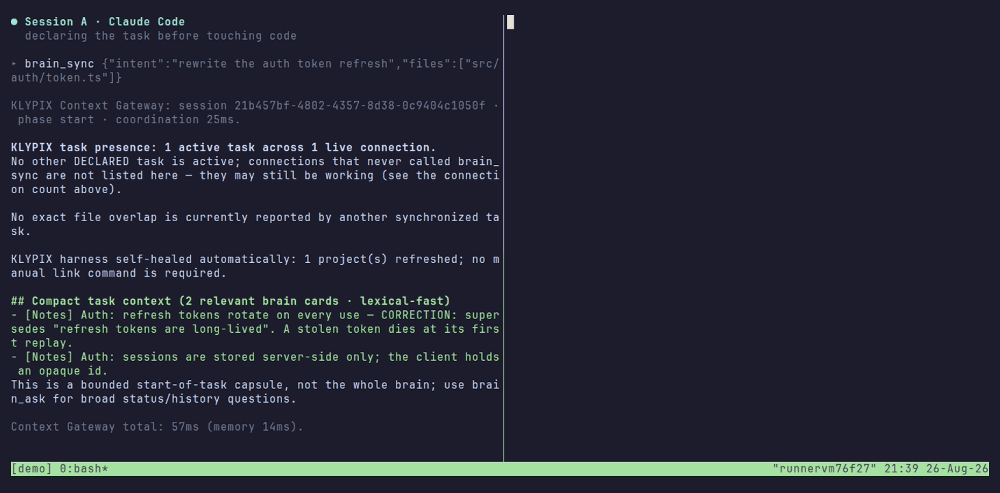

<div align="center">

# klypix-mcp

### Shared project memory for your coding agents, kept in your repo.

**One project. Many agents. One current understanding.**

[](https://www.npmjs.com/package/klypix-mcp)
[](https://github.com/dahshanlabs/klypix-mcp/actions/workflows/ci.yml)
[](LICENSE)
[](package.json)
[](https://modelcontextprotocol.io)

</div>


<sub>Real Claude Code sessions, hidden tests, no LLM judge, 8 Nov 2026. Drawn by CI from
[the results file](bench/coordination/results/2026-11-08-competitors.md); every row is published,
including the one KLYPIX loses. Four runs per cell; the report does not establish a general
ranking. Concord's live-delivery plugin was not enabled in this run. See the
[comparison scope and configuration limits](docs/comparison.md).</sub>

One `brain.klypix` file, committed with your code, holds what the project decided, what was
corrected, and what is still open. Claude Code, Codex, Cursor and other MCP coding tools read it
when a session starts and add to it as they work. When two sessions plan to touch the same file,
both get a heads-up. A person can open the same file and correct it.

Three things worth knowing before you install:

- **It runs without the app and without an account.** Linux, macOS and Windows. The engine makes
  no network calls and sends no telemetry.
- **Agents read plain text.** The brief lands in `AGENTS.md` / `CLAUDE.md` as a managed block,
  so every tool that reads instruction files already understands it.
- **Six tools by default.** `brain_sync`, `brain_note`, `brain_ask`, `brain_message`,
  `brain_handoff`, `brain_rules`. The other 23 (24 on Windows) are one flag away.



<sub>Real output, rendered by CI from a scripted run against this server, sped up 1.4×.
[How it is made](docs/demo/README.md).</sub>

## Install

You need Node.js 20 or newer. Run this inside your project:

```bash
npx klypix-mcp install
```

It gives the project a `brain.klypix` if it has none, wires the editors it finds on this machine
with the six core tools, registers the card-level `.klypix` merge driver in a git repo, and opens a
real MCP handshake to prove the tools answer before it exits. Reopen your coding tool, then:

```bash
npx klypix-mcp doctor      # what is installed, which profile, how many tools answered
```

No project at hand? Read the sample brain that ships in the package, a fictional weather app:

```bash
npx klypix-read node_modules/klypix-mcp/examples/showcase-brain.klypix
```

Want everything? `npx klypix-mcp install --tools all`, or set `KLYPIX_TOOLS=all` in the server's
environment. A comma list such as `KLYPIX_TOOLS=brain_sync,brain_note` also works.

## What you get

- **A brief at the start of every session.** The next session, in the same tool or another one,
  starts from what the project already decided. A correction replaces the old decision and keeps
  it as history.
- **A heads-up when work overlaps.** Each session says what it is doing and which files it expects
  to touch. When two sessions name the same file, both are told. Since 1.112.0 this covers every
  git worktree of one repository, not only one folder. KLYPIX warns; it never blocks an edit.
  [See it across two worktrees](docs/demo/demo-worktrees.gif) (real output, rendered by CI).
- **Notes and handoffs between sessions.** An agent can leave a note for another session, even one
  that has closed. When a session stops before its work is done, the next one is shown what it was
  doing, and a handoff card carries the next steps through git.
- **A one-line check for hooks and CI.** `npx klypix-mcp check src/auth.ts` exits 1 when a live
  session on this computer is working on that file, 0 when none is, 2 when it cannot tell. Use it
  in a pre-edit hook or a pre-commit step; you decide what to do with the answer.
  [Hook and CI snippets](docs/check-command.md).
- **A file you own.** The brain is a plain ZIP in your repo, versioned with git, mergeable card by
  card. MIT-licensed. Brain data stays in your files; your agent's model provider still receives
  what the agent reads.

## Hosts

| Host | What it gets | Set up by |
|---|---|---|
| **Claude Code** | Lifecycle hooks: a brief at session start, context on each prompt, automatic capture at turn end, presence and a git guard for a shared checkout | `install` |
| **Codex** | MCP tools, presence and `brain_sync`; optional hooks with `--codex-hooks`. No automatic capture | `install` |
| **Cursor, Cline, VS Code (Copilot / Continue), Gemini CLI, Antigravity** | MCP config and an always-on rules file. The agent calls `brain_sync` and `brain_note` itself | `install` or `link` |
| **Windsurf, Aider** | A rules file | `link` |
| **Claude, as a plugin** | One pinned version, keyword search, no hooks | [klypix-plugin](https://github.com/dahshanlabs/klypix-plugin) |

The [full host table](docs/REFERENCE.md#supported-hosts-and-their-integration-level) says exactly
how deep each integration goes.

## The numbers, including the ones we lose

The [coordination bench](bench/coordination/README.md) runs real Claude Code and Codex sessions on
seeded repositories and grades them with hidden tests; there is no LLM judge. The full run of
8 November 2026 put klypix-mcp 1.112.0 next to Concord MCP 0.20.0, MCP Agent Mail 0.3.40, a notes
file kept tidy by hand, and no shared channel
([write-up](bench/coordination/results/2026-11-08-competitors.md)):

- **Clear wins over Concord and Agent Mail** on four of nine scenarios: a work-in-progress note
  that outlived its session, its held-out twin, a decision made while the agent was working, and
  continuing the work a stopped session left. KLYPIX 4 of 4 each, both others 0 of 4.
- **Ties** on a changed decision, a note from an ended session, a live session that wrote nothing,
  and the harm check.
- **One loss, shared by every channel:** on two sessions changing overlapping work, a tidy notes
  file passed 4 of 4 and KLYPIX, Concord and Agent Mail 0 of 4. All three delivered the warning;
  the agents chose to tell the human rather than merge.
- **A notes file kept tidy by hand ties KLYPIX on most scenarios.** What it needs is a person who
  keeps it tidy.
- **Codex,** 3 runs each on four scenarios: KLYPIX 9 of 12, Agent Mail 5 of 12, Concord 0 of 12.
  Three runs is too few to call any single scenario.

Four runs per cell (five were planned; the run stopped at its budget). Clash and Agent-MCP are not
measured: no adapter exists. Claude spend $88.99; no run was invalid.

npm download counts for this package are mostly its own updater checking for new versions; do not
read them as users.

[How klypix-mcp compares](docs/comparison.md) to Concord MCP, MCP Agent Mail, Clash and Agent-MCP,
from their own READMEs.

## Reference

Everything else is in [docs/REFERENCE.md](docs/REFERENCE.md): how the brain works, every tool,
the command line, the git merge driver and the git guard, teammates on other computers over
[KLYPIX network](https://klypix.com/network), the Claude plugin, security and permissions, current
limitations, uninstall.

**Guides:** [shared project memory setup](https://klypix.com/guides/shared-project-memory) ·
[klypix.com/klypix-mcp](https://klypix.com/klypix-mcp)

KLYPIX does not launch, run, supervise or replace your agents. It is not an agent runtime, a model
router, a worktree manager or a replacement for git. It holds what the project currently believes.
The optional [KLYPIX workspace](https://klypix.com/developers) lets people inspect and correct the
same brain beside their files.

## Contributing

Issues and pull requests: [github.com/dahshanlabs/klypix-mcp](https://github.com/dahshanlabs/klypix-mcp).
Questions: [hello@klypix.com](mailto:hello@klypix.com). Run the tests with `npm test` from a clone.

## Licence

**MIT** ([`LICENSE`](LICENSE), history in [`NOTICE`](NOTICE)). Versions 1.29.0 through 1.111.0
were Apache-2.0; each published version keeps the terms it was released with. The KLYPIX desktop
app and klypix.com are separate, proprietary products; this package works with no app installed.

MIT © [Dahshan Labs](https://klypix.com).
